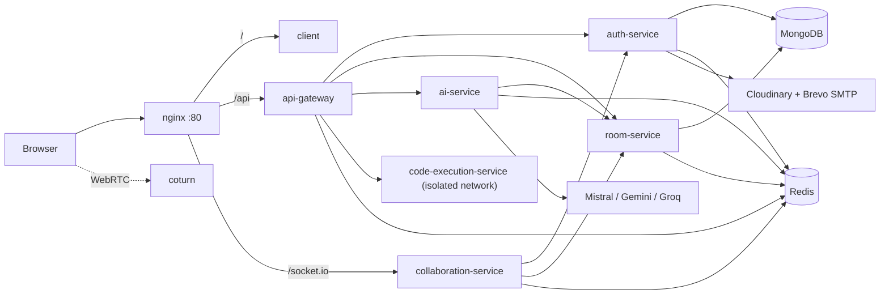

# Coduet

> **Code Together. Build Smarter.**

Coduet is a real-time collaborative coding workspace with in-browser code execution, AI assistance you stay in control of, video calls, and a structured technical-interview mode. It is built as a set of small services behind an API gateway and runs with a single `docker compose up`.

**Live demo:** coming soon · **Frontend README:** [client/README.md](client/README.md)


## Features

- **Real-time collaboration:** multi-user editing with live cursors and presence, built on Yjs (CRDT), so concurrent edits merge without conflicts.
- **Run code in the browser:** JavaScript, TypeScript and Python, with stdin support, in an isolated sandbox.
- **AI assistant:** review, explain, fix and chat about your code.
- **AI suggestions you control:** the AI proposes a diff, you review it, and nothing changes until you accept. A restore point is saved first, and stale suggestions are detected if the code changed underneath.
- **Interview mode:** owner, interviewers, candidate and observer roles, single-use candidate links, editor lock, a countdown timer, private scorecards, an event timeline and an interviewer-written summary (optionally drafted by AI).
- **Video calls:** peer-to-peer WebRTC (up to 6 people) with a TURN server for restricted networks. Video and audio are never recorded.
- **Version history:** snapshots with one-click restore, compare view and replay.
- **Rooms and invites:** room codes, `/join/:code` links with redirect-back after login, and per-member `editor` / `viewer` roles.
- **Accounts:** email signup, a one-click guest demo (24 hours), profile photos (Cloudinary) and password reset by email (Brevo SMTP).
- **Polished UI:** responsive layout with bottom-sheet panels on mobile, a custom Monaco theme and keyboard shortcuts (`Ctrl+Enter` run, `Ctrl+S` save, `Ctrl+K` command palette).

## Tech stack

| Layer | Technologies |
|---|---|
| Frontend | React 18, Vite, Tailwind CSS v4, Monaco Editor, Yjs + y-monaco, Socket.IO client, Framer Motion, Axios, DOMPurify, Sonner |
| Backend | Node.js, Express, Socket.IO, Yjs, Mongoose |
| Data | MongoDB, Redis (sessions, cache, rate limits, pub/sub, Yjs persistence) |
| AI | Mistral, Gemini and Groq (configurable) |
| Real-time media | WebRTC, coturn (STUN/TURN) |
| Integrations | Cloudinary (avatars), Brevo SMTP via Nodemailer (email) |
| Infrastructure | Docker Compose, nginx |

## Architecture



Every REST request goes through the gateway, which applies rate limits and verifies the JWT before proxying. Real-time traffic goes to the collaboration service, which verifies the same token itself. Permissions (who can edit, who can use AI) are checked on the server for every edit and AI call, never trusted from the client. See [docs/architecture.md](docs/architecture.md) for details.

## Services

| Service | Port | Responsibility |
|---|---|---|
| nginx | 80 | Entry point: static client, `/api` to the gateway, `/socket.io` to the collaboration service |
| api-gateway | 3000 | Rate limiting, authentication, request routing |
| auth-service | 4001 | Signup, login, guest sessions, JWT, Redis sessions, avatars, password reset |
| room-service | 4002 | Rooms, members and roles, files, snapshots, interviews, scorecards, timeline |
| collaboration-service | 4003 | Socket.IO, Yjs sync, presence, call signaling, Redis pub/sub |
| ai-service | 4004 | Review, fix, explain, chat, suggest, interview summary |
| code-execution-service | 4005 | Sandboxed runner for JavaScript, TypeScript and Python |
| coturn | 3478 | STUN/TURN for video calls |

## Quick start

**Prerequisites:** Docker with Compose v2, and Node.js 20+ only if you want to run things outside Docker.

```bash
# 1. Clone
git clone <your-repo-url> coduet
cd coduet

# 2. Configure
cp .env.example .env
# Fill in every value. Generate secrets with:
#   node -e "console.log(require('crypto').randomBytes(32).toString('hex'))"

# 3. Start everything
docker compose up -d --build
docker compose ps        # wait until all services are "healthy"

# 4. Open
# http://localhost
```

Cloudinary and SMTP values are only needed for avatars and email. The app works without them (set `MAIL_ENABLED=false` to skip sending). A full variable reference is in [docs/development.md](docs/development.md).

## Project structure

```
coduet/
├── client/                      # React frontend (see client/README.md)
├── services/
│   ├── api-gateway/
│   ├── auth-service/
│   ├── room-service/
│   ├── collaboration-service/
│   ├── ai-service/
│   └── code-execution-service/
├── shared/                      # Errors, error handler, internal-key auth, logger, constants
├── infrastructure/
│   ├── nginx/
│   ├── redis/
│   └── mongodb/
├── scripts/                     # dev.sh, deploy.sh, seed.sh
├── docs/
└── docker-compose.yml
```

## Scripts

```bash
./scripts/dev.sh up                    # start all services
./scripts/dev.sh down                  # stop all services
./scripts/dev.sh logs                  # follow logs
./scripts/dev.sh restart auth-service  # restart one service
./scripts/seed.sh                      # create demo users and rooms (set MAIL_ENABLED=false first)
./scripts/deploy.sh                    # deploy to an EC2 host (see docs/deployment.md)
```

## Documentation

| Doc | What is in it |
|---|---|
| [docs/architecture.md](docs/architecture.md) | Services, request and real-time flows, interview mode, data model, Redis keys, security |
| [docs/api.md](docs/api.md) | REST endpoints and WebSocket events |
| [docs/development.md](docs/development.md) | Local setup, environment variables, running without Docker, testing |
| [docs/deployment.md](docs/deployment.md) | Docker on a VPS/EC2, HTTPS, TURN, backups, troubleshooting |
| [docs/deployment-render.md](docs/deployment-render.md) | Alternative: Render + Vercel + managed MongoDB/Redis |

## Security at a glance

- JWT plus a Redis-backed session check on every request; logging in elsewhere invalidates the old session.
- Per-route rate limits (execution and AI are fail-closed), with much smaller budgets for guest accounts.
- Services trust each other through an internal API key; clients never reach internal routes.
- Code runs as an unprivileged user in a read-only container with no capabilities, CPU/memory/process limits and no network access.
- AI prompts treat code as data (nonce-delimited blocks), secrets in code are detected and blocked before reaching a model, and every AI edit is a diff a human accepts, with a restore point saved first.
- Passwords are hashed with bcrypt; password-reset tokens are random, stored hashed, single-use and expire after 15 minutes.

## AI quality

Prompts are guarded against injection and evaluated with the harness in `services/ai-service/evals/`; results are kept in `services/ai-service/evals/results/`. Guardrails: nonce-delimited data blocks, secret redaction and blocking, refusal handling, no evaluative language in interview summaries, free-form AI disabled in interview rooms, and human-reviewed diffs with restore points for every AI edit.

## Contributing

1. Fork the repository.
2. Create a feature branch: `git checkout -b feature/my-feature`.
3. Commit your changes: `git commit -m "Add my feature"`.
4. Push the branch and open a Pull Request.

## License

MIT. See [LICENSE](LICENSE).

Made by Devansh Kumar Tiwari.