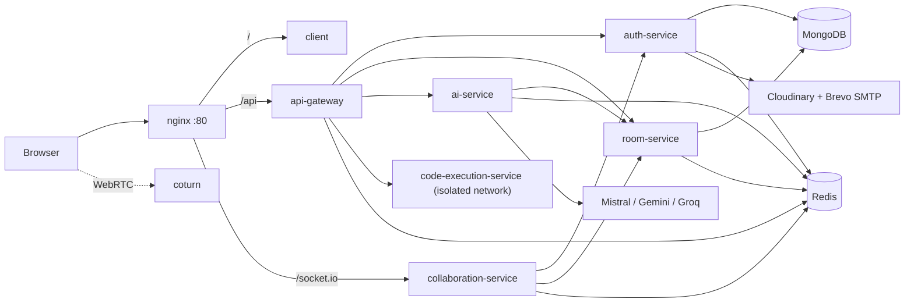

# Coduet: System Architecture

## Overview

Coduet is a set of small Node.js services. Each one has a single responsibility, talks to the others over HTTP (or WebSocket for real-time), and can be scaled on its own. nginx is the only public entry point in the Docker setup.



## Services

| Service | Port | Responsibility |
|---|---|---|
| nginx | 80 | Serves the client, proxies `/api/` to the gateway and `/socket.io/` to the collaboration service. Request-rate limits and upload size limit |
| api-gateway | 3000 | Rate limiting, JWT verification, request routing, identity headers for downstream services |
| auth-service | 4001 | Signup, login, guest sessions, JWT and Redis sessions, avatars, password reset |
| room-service | 4002 | Rooms, members and roles, files, snapshots, interviews, scorecards, timeline, summaries |
| collaboration-service | 4003 | Socket.IO, Yjs documents, presence, call signaling, role enforcement for edits |
| ai-service | 4004 | Review, fix, explain, chat, suggest, interview summary |
| code-execution-service | 4005 | Sandboxed execution of JavaScript, TypeScript and Python |
| coturn | 3478 | STUN/TURN relay for WebRTC calls |
| MongoDB / Redis | 27017 / 6379 | Primary database / sessions, cache, rate limits, pub/sub |

Host ports for MongoDB, Redis and the gateway are bound to `127.0.0.1` only. Everything else is reachable only through nginx.

## Request flow through the gateway

```
Browser -> nginx -> api-gateway
                      |
   1. Rate limit (per IP before auth, per user after auth)
   2. Authenticate: call auth-service /verify-token (JWT + Redis session)
   3. Set identity headers: x-user-id, x-user-data, x-user-guest
   4. Proxy to the target service with the internal API key
```

- Public routes (no token): `signup`, `login`, `guest`, `forgot-password`, `reset-password`.
- `/api/rooms/internal/*` is blocked at the gateway; those routes exist only for service-to-service calls.
- Downstream services read the caller's identity **only** from the gateway's headers, never from the request body.
- room-service, ai-service and code-execution-service require the internal API key. If it is not configured they refuse requests (fail closed).

### Rate limits

Window: 15 minutes. Budgets are per IP before authentication and per user afterwards.

| Route prefix | Limit | If Redis is down |
|---|---|---|
| `/api/execute` | 150 | `503` (fail closed) |
| `/api/ai` | 60 | `503` (fail closed) |
| `/api/auth` | 30 | request allowed |
| everything else | 600 | request allowed |

Guest accounts get smaller budgets: 20 for `/api/execute` and 10 for `/api/ai`. Responses carry `X-RateLimit-Limit`, `X-RateLimit-Remaining` and, on `429`, `Retry-After`. nginx adds a coarse per-IP limit in front (10 req/s on `/api/`, 5 req/s on `/api/auth/`).

## Real-time collaboration

Yjs (a CRDT) keeps every participant's document in sync without conflicts.

```
Alice types
  -> Monaco -> Yjs encodes a binary update
  -> socket "yjs-update"
  -> collaboration-service
       1. checks Alice may write (role, interview state)
       2. applies the update to the room's Y.Doc
       3. broadcasts to other sockets in the room
       4. publishes to Redis so other server instances do the same
  -> Bob's browser applies the update
```

- **Connect:** the client passes its JWT in the Socket.IO handshake (`auth.token`). The service verifies it with auth-service, so identity can't be forged by the client.
- **Join:** on `join-room` the service asks room-service for the caller's access. It then sends the full document state (`yjs-sync`) and the caller's permissions (`room-role`), so the UI can switch to read-only.
- **Enforcement:** viewers, locked or not-yet-started candidates and everyone in an ended interview cannot change the document. Roles are re-checked periodically, so a role change takes effect without reconnecting.
- **Persistence:** document state is stored in Redis (`ydoc:{roomId}`, 7-day TTL) and published over Redis channels so multiple collaboration instances stay consistent.
- **Presence:** cursors and user info (username, avatar) travel as awareness updates. The avatar URL comes from auth-service's `verify-token` response.

## Authentication

```
POST /api/auth/login
  1. find the user, compare the bcrypt hash
  2. remove any existing session for this user (one active login)
  3. sign a JWT (7 days) and store it in Redis: session:{userId}
  4. return { token, user }

Every later request: gateway -> auth-service GET /verify-token
  1. jwt.verify(token)
  2. a session for this user must exist in Redis
  3. return the user, including avatarUrl (from Redis)
```

- **Guests:** `POST /api/auth/guest` creates a temporary `Guest-xxxxxx` user (MongoDB TTL index) with a 24-hour token and reduced rate limits. Guests cannot upload avatars or receive email.
- **Avatars:** the client posts a multipart image (JPG/PNG/WEBP, max 2 MB). auth-service streams it to Cloudinary, cropped to 256x256 around the face, under a fixed public id per user (`avatars/user_{id}`) so a new upload replaces the old one. The URL is stored on the user and cached in Redis as `avatar:{userId}`.
- **Password reset:** `forgot-password` always answers the same way, whether or not the email exists. For real accounts it stores a SHA-256 hash of a random token in Redis (`pwreset:{hash}`, 15 minutes) and emails a link. `reset-password` consumes the token once, sets the new password and deletes the user's session so every device is logged out. There is also a 60-second per-email cooldown.

## Interview mode

A room has a `type` of `collab` or `interview`. Interview rooms add roles, a state machine and private evaluation tools.

### Roles

| Role | How you get it | Can edit | Notes |
|---|---|---|---|
| Owner | Created the room | Yes (until the interview ends) | Controls the interview, sees all scorecards, writes the summary, sees join codes |
| Interviewer | `editor` member who is not the candidate | Yes | Can fill a scorecard and view their own |
| Candidate | Joins with the single-use candidate code | Only while the interview is **live** and **not locked** | The code stops working once used |
| Observer | Joins with the observer code (stored as `viewer`) | No | Read-only |

Only the owner sees the join codes; other roles receive the room without them, so a candidate can't hand out the others' links.

### Interview lifecycle

```
scheduled --> live --> ended
     \-------------------^        (an interview can be ended before it starts)
```

- A candidate must be set (and be a room member) before the interview can go live.
- The owner can lock and unlock the candidate's editor, change the duration (5 to 240 minutes) and toggle AI assistance.
- Ending the interview stores the final document as a snapshot (`interview-end`) and freezes editing for everyone.

### Evaluation

- **Scorecards:** one per interviewer, with four ratings from 1 to 4 (problem solving, code quality, communication, testing), notes (up to 5,000 characters) and a recommendation (`strong_no`, `no`, `yes`, `strong_yes`). The owner sees all scorecards; other interviewers see only their own.
- **Summary:** the owner writes a summary (up to 8,000 characters). Once the interview has ended, AI can draft one from the interview's data, and the stored record notes whether it was AI-assisted. The AI is instructed to avoid evaluative language, since the human makes the call.
- **Timeline:** key events (room created, member joined, candidate set, started, ended, locked/unlocked, AI enabled/disabled, snapshot saved, scorecard saved, summary saved, call joined/left, screen share started/stopped) are recorded for the report.

### AI inside interviews

Free-form AI (review, explain, fix, chat) is **disabled** in interview rooms. When the owner turns AI assistance on, only **Suggest** is available, and only to people who can currently edit.

## AI service

- **Endpoints:** `review`, `explain`, `fix`, `chat`, `suggest` (returns a replacement for a selection) and `interview-summary`.
- **Providers:** Mistral, Gemini and Groq, selected through environment variables.
- **Access checks:** every call names a `roomId`, and the service asks room-service whether the caller may use AI there. Viewers may ask for explanations in normal rooms; suggestions need write access.
- **Prompt-injection hardening:** code is passed as data inside nonce-tagged delimiters, and the model is told never to follow instructions found inside it.
- **Secret blocking:** if the code or selection looks like it contains an API key, token or password, the request is rejected with `422` before reaching any model.
- **Bounded output:** replies are capped at 12,000 characters, suggested replacements are sanity-checked against the size of the selection, and refusals are handled explicitly.
- **Human in the loop:** Suggest returns a diff. Nothing changes until the user accepts it, and a `before-ai` snapshot is saved first. If the code changed since the suggestion was made, it is flagged as stale.

## Code execution

```
POST /api/execute/run { code, language, input }
  gateway: authenticate + rate limit (150 / 15 min, 20 for guests)
  code-execution-service:
    1. validate (language enabled, code <= 50,000 characters)
    2. write to a temp file in /tmp (a size-limited tmpfs)
    3. run as an unprivileged "sandbox" user with a 10 second timeout, stdin from `input`
    4. cap output at 512 KB, then delete the temp file
    5. return { stdout, stderr, executionTime }
```

The container runs with a read-only filesystem, all Linux capabilities dropped except those needed to switch to the sandbox user, `no-new-privileges`, a process limit (256), 512 MB of memory and 1 CPU. It is attached **only** to an internal Docker network shared with the gateway: it cannot reach Redis, MongoDB or the other services, and it has no outbound internet. Enabled languages are controlled by `ENABLED_LANGUAGES` (default `javascript,python,typescript`).

> Rooms and the AI validators also accept `java`, `cpp` and `go` as editor languages, but they cannot be executed unless you install the toolchains and enable them.

## Data model

### MongoDB

| Collection | Key fields |
|---|---|
| `users` | `username` (unique), `email` (unique), `password` (bcrypt hash), `isGuest`, `expiresAt` (TTL, guests), `avatarUrl`, timestamps |
| `rooms` | `name` (max 50), `code` (unique), `owner`, `members[{ userId, username, role: editor/viewer, joinedAt }]`, `language`, `type` (collab/interview), `interview{ candidateId, candidateCode, observerCode, locked, aiAssist, status, durationMin, startedAt, endedAt }`, `isActive` |
| `files` | `roomId`, `filename` (unique per room), `content`, `language`, `savedBy` |
| `snapshots` | `roomId`, `text` (max 150,000 chars), `language`, `kind` (manual, auto, before-ai, before-restore, interview-end), `size`, `createdBy`, `createdByName`. Newest 200 per room are kept |
| `scorecards` | `roomId`, `interviewerId` (unique per room), `ratings{ problemSolving, codeQuality, communication, testing }`, `notes`, `recommendation` |
| `interviewevents` | `roomId`, `type`, `actorId`, `actorName`, small flat `meta`, `at` |
| `interviewreports` | `roomId` (unique), `text`, `aiAssisted`, `updatedById`, `updatedByName` |

### Redis keys

| Key | Purpose | TTL |
|---|---|---|
| `session:{userId}` | Active JWT for the user | 7 days (guests: 24 h) |
| `avatar:{userId}` | Avatar URL returned by `verify-token` | none |
| `pwreset:{sha256}` | Password reset token, value is the user id | 15 minutes |
| `pwreset:cd:{email}` | Cooldown against reset-mail spam | 60 seconds |
| `room:{roomId}`, `room:code:{code}` | Room cache (cache-aside) | 1 hour |
| `ydoc:{roomId}` | Persisted Yjs document state | 7 days |
| `rate_limit:{prefix}:{ip or user}` | Rate-limit counters | 15 minutes |
| pub/sub channels `yjs:{roomId}`, `awareness:{roomId}` | Multi-instance sync | n/a |

Redis runs with `maxmemory-policy volatile-lru`, so only keys with a TTL can be evicted under memory pressure (keys such as `avatar:*` are never evicted).

## Security measures

| Threat | Protection |
|---|---|
| Brute-force login | 30 requests / 15 min on `/api/auth` plus nginx 5 req/s; one active session per user |
| Forged identity | JWT verified against a Redis session; services read identity only from gateway headers; sockets verify the token themselves |
| Calling internal services directly | Internal API key (fail closed); `/api/rooms/internal` blocked at the gateway; internal network is not published |
| Unauthorized edits or AI use | Role checks in room-service, collaboration-service and ai-service on every action |
| Malicious code execution | Unprivileged user, read-only filesystem, dropped capabilities, resource limits, 10 s timeout, no network |
| Prompt injection | Nonce-delimited data blocks, bounded output, human-reviewed diffs |
| Secrets leaking to AI providers | Detection and blocking before the request is sent |
| Account enumeration | Password-reset response is identical for known and unknown emails |
| Reset-token theft from a database leak | Tokens are stored hashed, single-use and short-lived |
| Malicious uploads | Type allow-list and 2 MB limit, memory storage only, processed by Cloudinary |
| XSS in AI or user content | DOMPurify on rendered content |
| Credential exposure | `.env` files are git-ignored and excluded from Docker build contexts |

## Scaling

The collaboration service is the part that scales horizontally. nginx uses `ip_hash` for `/socket.io/`, and Redis pub/sub relays Yjs and awareness updates between instances, so users in the same room can be connected to different instances.

```
nginx (ip_hash)
  |-- collaboration-service #1 \
  |-- collaboration-service #2  } shared Redis pub/sub + shared MongoDB
  '-- collaboration-service #3 /
```

To run more than one instance, remove the fixed `container_name`, give each instance a unique `SERVER_ID` and add it to the nginx upstream. The other stateless services (gateway, auth, room, ai, executor) can be scaled the same way behind the Docker network.